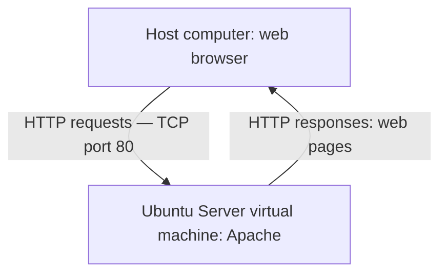

# Apache Installation on Ubuntu Server

## 1. Goal Architecture

The goal is to install Apache on an Ubuntu Server virtual machine. A web browser on the host computer will send HTTP requests to the server. Apache will listen on TCP port 80 and return web pages.

The virtual machine network must allow communication between the host computer and Ubuntu Server.

