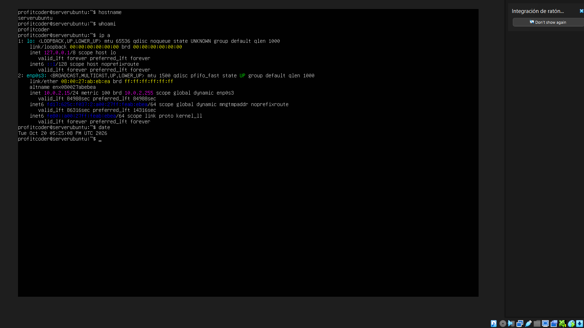

# Apache Installation

## 1. Goal Architecture

I will install Apache on an Ubuntu Server virtual machine. A browser on my computer will connect to Apache to request web pages.

- Client: my computer and its web browser.
- Server: the Ubuntu Server virtual machine with Apache.
- Connection: HTTP using TCP port 80.

## 2. Check Server Information

Check the server name:

```bash
hostname
```

Check my username:

```bash
whoami
```

Check the IP address:

```bash
ip a
```

Check the server date and time:

```bash
date
```

Results:



## 3. Update Ubuntu

```bash
sudo apt update
```

This updates the list of available packages.

Result:

[Paste the actual result here.]

## 4. Install Apache

```bash
sudo apt install apache2
```

Type `Y` and press Enter to confirm.

Result:

[Paste the actual result here.]

## 5. Check Apache

```bash
sudo systemctl status apache2
```

Expected result:

```text
Active: active (running)
```

This means Apache is running.

[Insert a screenshot of your result.]

Press `q` to leave this screen.

## 6. Check Automatic Startup

```bash
sudo systemctl is-enabled apache2
```

Expected result:

```text
enabled
```

This means Apache will start automatically when the server boots.

My result:

[Paste the actual result here.]

## 7. Stop Apache

```bash
sudo systemctl stop apache2
sudo systemctl status apache2
```

Expected result:

```text
Active: inactive (dead)
```

This means Apache is stopped.

[Insert a screenshot of your result.]

## 8. Start Apache

```bash
sudo systemctl start apache2
sudo systemctl status apache2
```

Expected result:

```text
Active: active (running)
```

This means Apache is running again.

[Insert a screenshot of your result.]

## 9. Reload Apache

```bash
sudo systemctl reload apache2
```

If it works, this command normally displays no message.

- `start` starts Apache when it is stopped.
- `reload` reads the configuration again while Apache is running.

My result:

[Write what happened here.]

## 10. Check the Apache Port

```bash
sudo netstat -tulpn
```

If Ubuntu says the command is not found, install it:

```bash
sudo apt install net-tools
```

Then run the command again:

```bash
sudo netstat -tulpn
```

[Insert a screenshot of the result.]

### Port number

Apache normally uses port **80** for HTTP. I must check this in my result.

### Protocol

Apache uses **TCP** for this HTTP connection. It may appear as `tcp` or `tcp6`.

### LISTEN status

`LISTEN` means the server is waiting for incoming connections.
