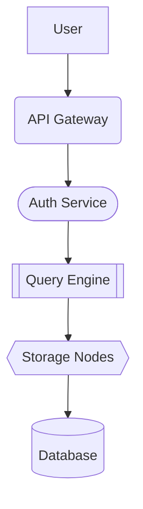

# Nebula DB Documentation Project

This is for a DataBase for a high tech performance, developed to act quick and with tolerance on the erros.


## Indice

- [Arquitecture](#Architecture)
- [Components]()
- [Instalation]()
- [Configuration]()
- [Api]()
- [Diagram]()
- [Task]()
- [license]()

## Architecture

This DataBase uses a distributed form, that is done by the next services:

* API Gateway
    * Point for external request.
    * Manage the traffic
* Auth Service
    * It manages the authentification and the authorization
    * It sends and validate access tokens
* Query engine
    * Analyze and executes queries
    * It moves different operations between storage nodes
* Storage nodes
    * Storage data information on paper
    * Allows reaplication and horizontal scalability
* Monitoring
    * Get system metrics.
    * Generate alerts between erros and service degragation


| Components | Languaje | State | Version | Dependence |
|------------|----------|-------|---------|------------|
|API Gateway |    GO    |Estable|  2.4.1  |Redis<br>Prometheus|
|    Auth    |   Rust   |Estable|  2.3.0  |PostgreSQL<br>JWT|
|Query Engine|    C++   |   Beta|  3.0.0  |gRPC<br>LLVM|
|Storage Node|   Rust   |Estable|  4.1.2  |Rocks<br>Raft|
|Monitoring  |  Python  |Experimental|--|Prometheus<br>Grafana|

## Installation

Fictional installation example. Clone the repository and run the installer:

```bash
git clone https://example.com/nebuladb.git
cd nebuladb
./install.sh
```

Verify that the installation completed successfully:

```bash
nebuladb --version
```

## Diagram

The following diagram shows how a request flows through the system:



## Links

- Read the [advanced documentation](https://example.com/advanced).
- Contact the team: [support@nebuladb.example](mailto:support@nebuladb.example).

## Image


## Tasks

- [x] Design the initial architecture.
- [x] Implement the API Gateway.
- [x] Implement JWT authentication.
- [ ] Add automatic replication.
- [ ] Implement distributed queries.
- [ ] Create the monitoring dashboard.
- [ ] Release version 3.0.

---

> We build NebulaDB so that infrastructure complexity stays invisible to application developers.
>
> — The NebulaDB Team

**Last updated:** October 15, 2026.

## License

NebulaDB is distributed under the **Apache License 2.0**.

Read the [full license text](https://www.apache.org/licenses/LICENSE-2.0).
